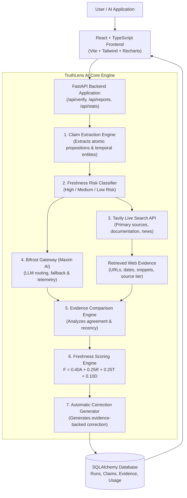
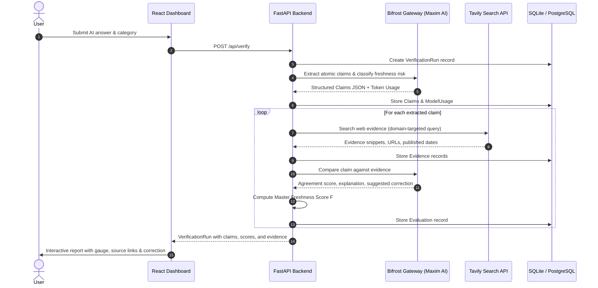
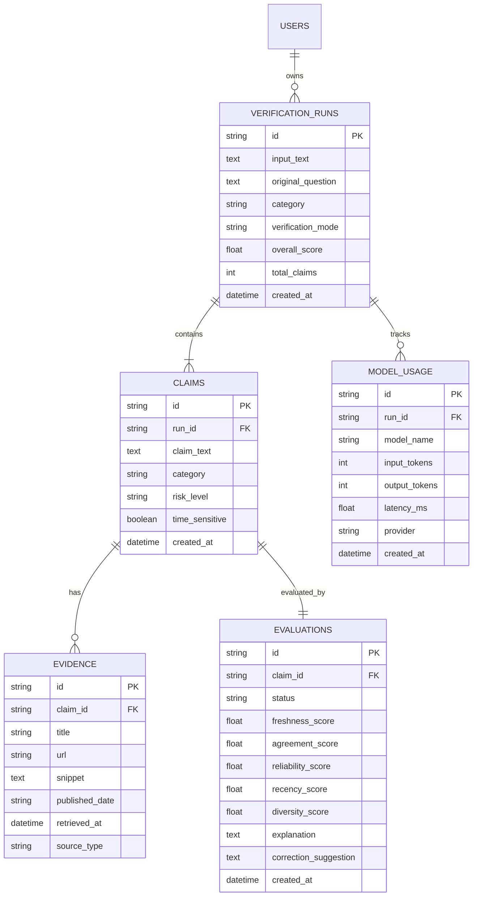

# TruthLens AI - System Architecture

## 1. High-Level System Architecture

TruthLens AI is an intelligent verification and information freshness platform designed to detect stale, outdated, or contradicted claims in AI-generated answers. It integrates **Bifrost by Maxim AI** as the centralized LLM gateway and **Tavily** for live web search and evidence retrieval.

---

## 2. Verification Pipeline Sequence Flow

---

## 3. Database Entity-Relationship Model (ERD)

---

## 4. Freshness Scoring Engine Mathematical Formulation

The freshness score ($F$) is evaluated on a scale of $0$ to $100$ according to the master formula:

$$F = 0.40A + 0.25R + 0.25T + 0.10D$$

Where:
- **$A$ (Agreement Score, $0-100$):** Semantic alignment between the claim and the retrieved live web evidence.
- **$R$ (Source Reliability, $0-100$):** Weighted authority tier:
  - Official documentation & registry domains (e.g. `docs.python.org`, `github.com`): $95$
  - Government & military domains (`.gov`, `.mil`): $95$
  - Academic institutions & arXiv (`.edu`, `arxiv.org`): $90$
  - Technical documentation: $85$
  - Verified news publishers: $75$
  - General web: $60$
- **$T$ (Evidence Recency, $0-100$):** Decay function based on publication/update year relative to the claim's freshness risk category (steep decay for High Risk; moderate for Medium Risk; gentle for Low Risk).
- **$D$ (Source Diversity, $0-100$):** Domain independence and variety across evidence sources.

If no authoritative evidence is found, the status is set to `UNVERIFIED` and the score evaluates to $0.0$, preventing misleading hallucinated ratings.
